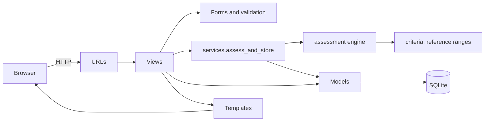
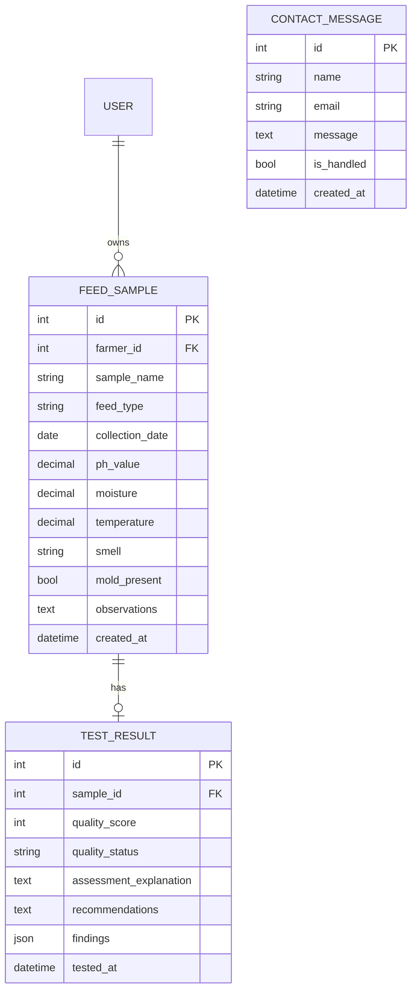

# NutriFarm AI

A Django web application for recording, screening, and tracking dairy **feed and silage samples**. Farmers create private accounts, submit sample measurements, and receive a transparent, rule-based screening score with per-check explanations and recommendations.

> [!IMPORTANT]
> Despite the project name, the assessment engine is **not a trained AI model**. It compares measurements with reference ranges and explains the outcome. It has **not been validated against laboratory results** and does not certify feed quality or safety. Real decisions should rely on laboratory testing and qualified agricultural advice.

## Features

- Farmer registration and login (session based, `next` redirect supported)
- Sample submission, **editing**, and **deletion** with server-side validation
- **Feed-type-specific** reference ranges (corn silage, haylage, hay, green fodder, dry fodder, concentrate, …)
- A documented **0–100 screening score** with a per-parameter breakdown, explanations, and recommendations
- Sample history with **filters** (feed type, result) and **pagination**
- **CSV export** of a farmer's samples and results (spreadsheet-formula safe)
- Dashboard with totals, samples needing review, and average score
- Public contact form stored for staff in Django admin
- Per-farmer data isolation (another farmer's record returns 404)
- Django admin for samples, results (inline), and contact messages

## Architecture



| Module | Responsibility |
| --- | --- |
| `nutrifarm/` | Settings (environment driven), root URLs, WSGI/ASGI |
| `core/` | Public homepage |
| `testing/models.py` | `FeedSample`, `TestResult`, `ContactMessage`; feed-type and smell choices (single source of truth) |
| `testing/criteria.py` | **All reference ranges and score weights** (plain data; edit here) |
| `testing/assessment.py` | Pure assessment logic: findings, status, score. No database access |
| `testing/services.py` | Combines assessment with persistence (`assess_and_store`) |
| `testing/forms.py` | Forms with a shared Bootstrap mixin |
| `testing/views.py` | Thin views; ownership enforced by one helper |
| `templates/`, `static/` | Layout, pages, CSS, JavaScript |

## How the assessment works

Five checks are made on every sample. Each produces a finding at one of four levels:

| Level | Meaning | Credit |
| --- | --- | --- |
| Optimal | Within the optimal band for the feed type | 100 % of the weight |
| Borderline | Acceptable, but outside the optimal band | 50 % |
| Flagged | Outside the acceptable band, off smell, or visible mold | 0 % |
| Missing | Input absent or unusable | no score is produced |

| Check | Weight |
| --- | --- |
| pH | 25 |
| Moisture | 25 |
| Temperature | 15 |
| Smell | 20 |
| Visible mold | 15 |

**Category** (stored as `quality_status`):

- **Incomplete**: any input is missing or unusable (score is empty)
- **Needs review**: at least one check is flagged
- **Borderline**: nothing flagged, but at least one check is borderline
- **Within prototype criteria**: every check is optimal

**Score caps** keep the number consistent with the category: any flagged check limits the score to 69, and visible mold limits it to 40.

Re-evaluating a sample updates its single `TestResult`. Editing an already-assessed sample refreshes the assessment automatically so a stored result is never stale.

### Reference ranges

Ranges live in [`testing/criteria.py`](testing/criteria.py). Silage values follow published extension guidance (Kung & Shaver, University of Wisconsin–Madison Extension; Amaral-Phillips, University of Kentucky Cooperative Extension). Everything else is a simplified screening value.

| Feed type | pH optimal | Moisture optimal (%) | Basis |
| --- | --- | --- | --- |
| Corn silage | 3.7–4.2 | 60–70 | Extension guidance |
| Haylage (grass/legume) | 4.3–5.0 | 45–65 | Extension guidance |
| Silage (general) | 3.7–4.7 | 55–70 | Blend of the two |
| Green fodder | 5.5–7.0 | 70–85 | Simplified |
| Hay | 5.5–7.0 | 8–15 | Simplified |
| Dry fodder | 5.5–7.0 | 5–12 | Simplified |
| Concentrate | 5.5–7.0 | 8–12 | Simplified |
| Other | 5.5–7.0 | 10–70 | Deliberately wide |

Each parameter also has a wider *acceptable* band. Temperature uses one general band (optimal 5–30 °C, acceptable 0–40 °C) because the form does not record ambient temperature.

> [!WARNING]
> Only the silage pH/moisture ranges are tied to cited sources. Have an animal nutritionist or your institution's references (for example ICAR / NDDB guidance) review every value before relying on this tool.

## Data model



Database check constraints enforce pH 0–14, moisture 0–100 %, and score 0–100. Deleting a user cascades to their samples; deleting a sample cascades to its result.

## Pages

| Area | URL | Access |
| --- | --- | --- |
| Home / About / Features / Contact | `/`, `/about/`, `/features/`, `/contact/` | Public |
| Register / Log in | `/register/`, `/login/` | Public |
| Log out | `/logout/` | POST only |
| Dashboard | `/dashboard/` | Authenticated |
| Submit sample | `/samples/submit/` | Authenticated |
| Sample history (filter + pages) | `/samples/?feed_type=&status=&page=` | Authenticated |
| CSV export | `/samples/export.csv` | Authenticated |
| Sample detail | `/sample/<id>/` | Owner only |
| Edit / delete sample | `/sample/<id>/edit/`, `/sample/<id>/delete/` | Owner only |
| Evaluate (POST) / result | `/sample/<id>/evaluate/`, `/sample/<id>/result/` | Owner only |
| Django admin | `/admin/` | Staff |

## Local setup

Requires Python 3.12 or newer.

```powershell
py -m venv .venv
.\.venv\Scripts\Activate.ps1
python -m pip install -r requirements-dev.txt
python manage.py migrate
python manage.py runserver
```

Open <http://127.0.0.1:8000/>. Create an admin user with `python manage.py createsuperuser`, then visit `/admin/`.

### Configuration

Development runs without a `.env` file. Copy `.env.example` to `.env` to customise.

| Variable | Purpose | Default |
| --- | --- | --- |
| `DJANGO_DEBUG` | Debug mode | `True` |
| `DJANGO_SECRET_KEY` | Required when debug is off | dev-only key |
| `DJANGO_ALLOWED_HOSTS` | Comma-separated hosts | `localhost,127.0.0.1` in debug |
| `DJANGO_CSRF_TRUSTED_ORIGINS` | Comma-separated origins | empty |
| `DJANGO_TIME_ZONE` | Zone used for "date cannot be in the future" | `Asia/Kolkata` |
| `DATABASE_URL` | PostgreSQL connection URL; SQLite is used when unset | unset |
| `SECURE_HSTS_SECONDS` | HSTS lifetime in production | `31536000` |

The shorter aliases `DEBUG`, `SECRET_KEY`, and `ALLOWED_HOSTS` are also accepted.

### Production

```powershell
$env:DJANGO_DEBUG = "False"
$env:DJANGO_SECRET_KEY = "<long random value>"
$env:DJANGO_ALLOWED_HOSTS = "example.com"
python manage.py collectstatic --noinput
gunicorn nutrifarm.wsgi
```

With debug off, HTTPS redirect, secure cookies, HSTS, and content-type protection are enabled, and WhiteNoise serves the collected static files. SQLite is fine for development. Set `DATABASE_URL` to use PostgreSQL on hosts whose file system is not persistent.

### Deploying on Render

`build.sh` installs dependencies, collects static files, migrates, and creates the admin user from `DJANGO_SUPERUSER_USERNAME`, `DJANGO_SUPERUSER_EMAIL` and `DJANGO_SUPERUSER_PASSWORD` (free Render services have no shell). Use:

- Build command: `bash build.sh`
- Start command: `gunicorn nutrifarm.wsgi:application`
- Environment: `DJANGO_DEBUG=False`, `DJANGO_SECRET_KEY`, `DATABASE_URL` (from a Render Postgres database), `PYTHON_VERSION`, and the three superuser variables.

Render's public hostname is trusted automatically through `RENDER_EXTERNAL_HOSTNAME`. Free Render services sleep after 15 minutes idle, and free Render Postgres databases expire after 30 days.

## Tests and code quality

```powershell
python manage.py test      # 72 tests
ruff check .               # lint
ruff format .              # format
```

Tests live in `testing/tests/` (one module per area) with shared helpers in `factories.py`. They cover accounts, privacy and ownership, validation, edit/delete, filtering and pagination, CSV export (including formula injection), the assessment engine (boundaries, scoring, per-feed-type behaviour, malformed input), admin, and the full farmer workflow. GitHub Actions (`.github/workflows/ci.yml`) runs lint, a migration check, and the tests on every push.

## Security notes

- CSRF protection on every state-changing form; mutations are POST-only
- Hashed passwords with Django's validators; unique email addresses
- Open-redirect-safe `next` handling on login (Django's `LoginView`)
- Ownership enforced in every sample query
- CSV export neutralises cells that begin with `=`, `+`, `-`, `@`
- Contact form includes a honeypot field against basic bots (add rate limiting before a public launch)

## Limitations and next steps

- The engine is rule-based. A machine-learning model would need a labelled dataset of samples with laboratory outcomes, which does not exist yet; `assessment.assess_sample` is the single seam where one could be added.
- Reference ranges outside silage are simplified and unverified (see above).
- Temperature is judged in absolute terms; recording ambient temperature would allow the more meaningful "degrees above ambient" check.
- No laboratory, sensor, or image-analysis integration.
- Ideas: trend charts per feed pile, laboratory result upload, notifications, advisor roles, password reset by email.
